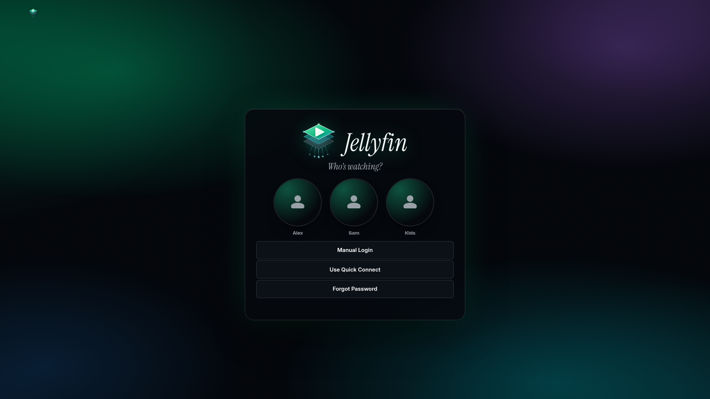
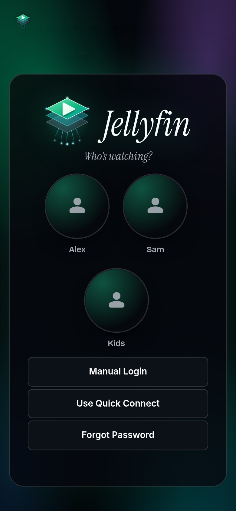

# Aurora Glass for Jellyfin 12

A theme for the Jellyfin 12 web client: a deep ink-black base, a slowly drifting aurora of emerald, teal and violet behind translucent glass, hairline borders and a palette that follows the artwork on screen. It ships as one stylesheet and one small script.

This repository only holds the release files. The theme's source is private.





## Quick start

You need Jellyfin 12, the **JavaScript Injector** plugin (Dashboard > Plugins > Catalog) and an API key (Dashboard > API Keys).

```
curl -fsSL https://github.com/scotthowson/jellyfin-aurora-glass-releases/releases/latest/download/install.sh | bash -s -- --url http://localhost:8096 --api-key YOUR_API_KEY
```

Then reload the Jellyfin page (Ctrl+Shift+R). No restart is needed. This works the same for Docker and for package installs: the installer talks to Jellyfin's API, so run it anywhere that can reach `--url`.

## What the installer does

1. Downloads `custom.css` and `custom.js` of the release and checks their sha256.
2. Backs up your branding settings and JavaScript Injector configuration to `./aurora-glass-backup-<time>.json`. With `--container jellyfin` it also copies the plugin's XML file.
3. Writes `custom.css` into Dashboard > General > Custom CSS. Your login disclaimer and splash screen setting are kept.
4. Writes `custom.js` as the JavaScript Injector entry **Aurora Glass FX**. Other entries are not touched.
5. Checks that Jellyfin serves the new CSS and that the entry is there.

Options: `--dry-run`, `--no-js` (CSS only, no plugin needed), `--version X`, `--from DIR` (files you already downloaded), `--container NAME`, `--uninstall`.

## Install by hand

1. Download `custom.css` and `custom.js` from the [latest release](https://github.com/scotthowson/jellyfin-aurora-glass-releases/releases/latest).
2. Paste `custom.css` into Dashboard > General > Custom CSS and save.
3. In Dashboard > Plugins > JavaScript Injector, add a script named `Aurora Glass FX` with the contents of `custom.js`, Enabled, "Requires authentication" on. Save.
4. Reload the page.

The CSS works on its own; the script adds the behaviours listed below.

## Switches

Every feature has a switch. Add a block like this at the end of Custom CSS (1 = on, 0 = off):

```css
:root {
    --dcs-fx-parallax: 0;      /* turn the details-page parallax off */
    --dcs-trailer-volume: 25;  /* Media Bar trailer volume, % */
}
```

| Switch | What it does |
|---|---|
| `--dcs-fx-greeting` | "Good evening, name" on the home page |
| `--dcs-fx-sync` | the accent colour follows the artwork on screen |
| `--dcs-fx-tilt` | spotlight cards: a light and rim follow the pointer, with a gentle tilt (off on touch and TV) |
| `--dcs-fx-parallax` | the details backdrop moves slower than the page |
| `--dcs-fx-transition` | a short fade between pages |
| `--dcs-fx-gate` | the details backdrop opens like a projector gate (needs `transition`) |
| `--dcs-fx-autohide` | the header hides while you scroll down and returns when you scroll up |
| `--dcs-fx-nav` | the header's libraries in one glass capsule with a sliding indicator; icons only when plugins crowd the bar |
| `--dcs-fx-carousel` | recommendation rows become a carousel (`--dcs-carousel-match` picks the rows) |
| `--dcs-fx-focus` | visible keyboard focus on posters and titles |
| `--dcs-fx-titles` | the same accent tick and indent on every home row title |
| `--dcs-fx-rails` | one card width per row |
| `--dcs-fx-thread` | a thin aurora line at the top fills as the page scrolls |
| `--dcs-fx-onair` | the avatar ring breathes while something plays |
| `--dcs-fx-hero`, `-dots`, `-ambient`, `-reveal`, `-advance`, `-volume`, `-hoversound`, `-away` | Media Bar plugin: rebuild an empty hero, position dots, ambient glow, trailer reveal, auto-advance, volume, hover sound, pause while scrolled away |
| `--dcs-fx-cast` | Cast & Crew age chips placed where the photo has room (Jellyfin Enhanced / ActorPlus) |
| `--dcs-fx-trayclick`, `-badgelink` | Jellyfin Enhanced header buttons and Achievement Badges each open their own page |
| `--dcs-fx-pickers` | Jellyfin Enhanced "Search Settings" boxes open their list on click |

`prefers-reduced-motion` turns every animation off.

## Your own name on the sign-in card

The sign-in card shows the Aurora mark and "Jellyfin". To show your own artwork instead, take `branding.css` from the release, point its `url()` at your image and paste it at the end of Custom CSS.

## Works with

Built and tested on Jellyfin 12.2 with the modern layout. It loads [ElegantFin](https://github.com/lscambo13/ElegantFin) and its [Jellyfin 12 companion](https://github.com/mihaif7/elegantfin-jf12) (pinned versions, from jsDelivr) as the structural layer, and themes these plugins when they are installed: Media Bar, Jellyfin Enhanced, Home Screen Sections, KefinTweaks, Achievement Badges, Intro Skipper.

## Uninstall

```
curl -fsSL https://github.com/scotthowson/jellyfin-aurora-glass-releases/releases/latest/download/install.sh | bash -s -- --url http://localhost:8096 --api-key YOUR_API_KEY --uninstall
```

This empties Custom CSS (only if it holds this theme) and removes the Aurora Glass FX entry. Or put back the JSON backup the installer made.

## Checksums

Each release carries `SHA256SUMS`. The installer checks the files against the sha256 it was built with.

## Licence and credit

MIT, see [LICENSE](LICENSE). By Scott Howson. ElegantFin by lscambo13 and the Jellyfin 12 companion by mihaif7 are loaded from their own repositories under their own licences; the Intro Skipper button skin comes from intro-skipper/intro-skipper-css.
